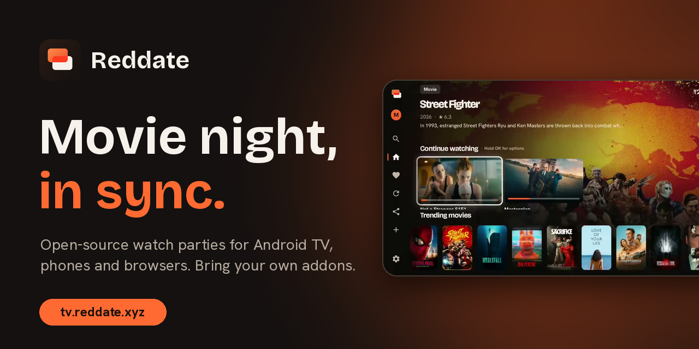
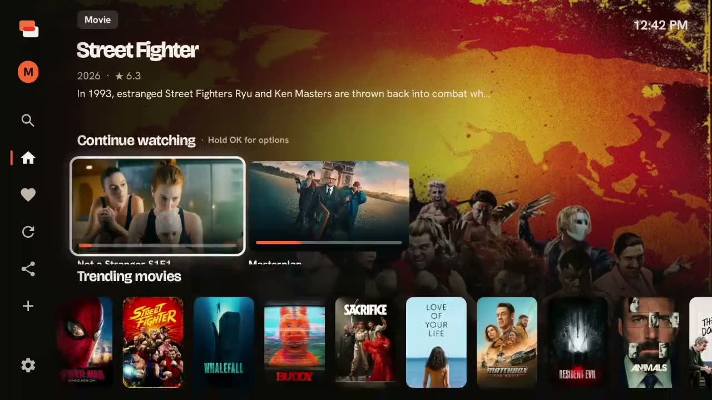
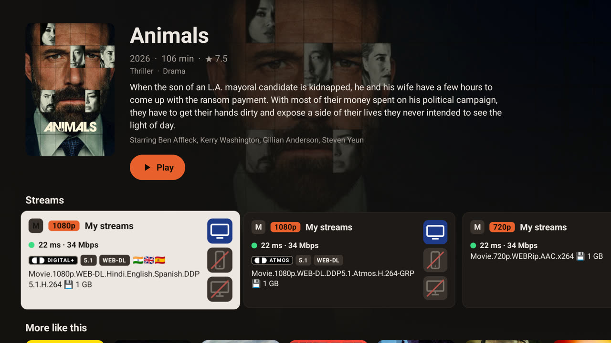
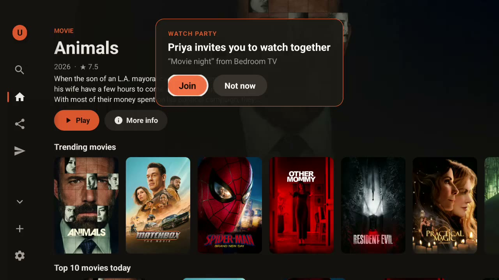
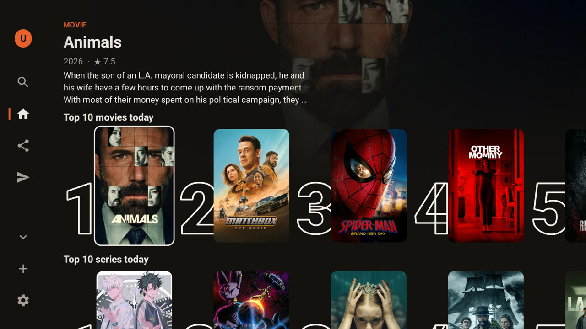
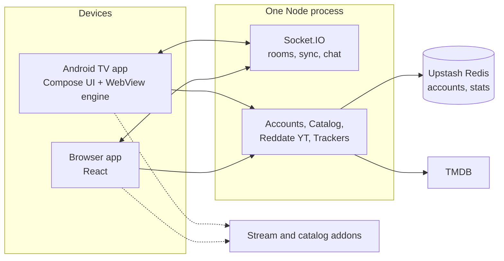

<p align="center">
  
</p>

<h1 align="center">Reddate</h1>

<p align="center">
  <b>Movie night, in sync.</b><br>
  An open-source watch-party app for Android TV, phones and browsers.<br>
  Everyone presses play together, the best stream is picked for you, and you bring your own addons.
</p>

<p align="center">
  <a href="https://tv.reddate.xyz/download"><b>Download for Android TV</b></a> ·
  <a href="https://tv.reddate.xyz/app">Open in the browser</a> ·
  <a href="https://tv.reddate.xyz/addon-list">Addons</a> ·
  <a href="docs/">Docs</a> ·
  <a href="https://discord.gg/UubFc9Kw3d">Discord</a>
</p>

<p align="center">
  <a href="LICENSE"></a>
  <a href="../../releases/latest"></a>
  
  
  
  <a href="https://discord.gg/UubFc9Kw3d"></a>
</p>

---

## What it is

- **Watch together.** Start a room from your TV, share a code or a QR, and everyone's player stays in step. A host controls playback; guests choose their own subtitles.
- **A TV app that feels native.** Home with Top 10 rows per streaming service, Continue watching, big posters, a remote-friendly layout and a stream picker that shows speed and device support before you press play.
- **You bring the sources.** Reddate speaks the Stremio addon format, so the catalogs and stream sources you already use work. Reddate hosts no video.

## See it

<table>
  <tr>
    <td width="50%"><br><sub><b>Home.</b> Continue watching, trending and Top 10 rows, per profile.</sub></td>
    <td width="50%"><br><sub><b>Streams.</b> Speed, quality, language and device checks, best first.</sub></td>
  </tr>
  <tr>
    <td width="50%"><br><sub><b>Invite.</b> One press for a code and a QR. It works until the room closes.</sub></td>
    <td width="50%"><br><sub><b>Top 10.</b> The ten most-watched titles on each service in your country.</sub></td>
  </tr>
</table>

Poster and still images in these pictures belong to their owners.

## Features

**Watch parties**
- Rooms start only when you invite someone, so watching alone creates nothing on the server.
- One shared "anchor" position. Every player steers itself toward it, so a slow connection catches up without dragging the room back.
- Hosts (more than one is possible) play, pause and seek. A host who drops out has a short grace period before control passes to a guest.
- Chat with pop-ups over the video on TV, and a voice and video lounge on phones and computers.

**Home and discovery**
- Top 10 per service (Netflix, Prime Video, Disney+, Apple TV+, Max and more), trending, popular, genres and search.
- Profiles, one per person, each with its own Home rows, addons, Continue watching and tracking.
- A calendar of upcoming releases and watch tracking with Trakt and Simkl.

**Streams and subtitles**
- Streams are ranked before you choose: speed measured on your connection, quality, audio languages, and whether your TV, phone or computer can play them.
- Subtitles in any language, per viewer, with delay, size, colour and position.

**Addons**
- Any Stremio-compatible addon (catalogs, streams, subtitles).
- **Reddate Catalog**: movies and series from TMDB, with your country and rows chosen on the [addons page](https://tv.reddate.xyz/addon-list).
- **Reddate YT**: YouTube trending, music, gaming, news, search and channels, with your own free YouTube API key. It plays in Reddate's own player, with the room tools one press away.

**Privacy**
- Rooms live in memory and disappear when everyone leaves. Chat is relayed, never stored or logged. See [docs/PRIVACY.md](docs/PRIVACY.md) for exactly what is and isn't private.

## How it fits together



Read more in [docs/ARCHITECTURE.md](docs/ARCHITECTURE.md).

## Run it yourself

```bash
git clone https://github.com/UdayHelps/Reddate.git
cd Reddate
npm install
npm start            # http://localhost:3000
```

Everything optional (accounts, the movie catalog, GIFs, stats) turns on with environment variables; copy `.env.example` to `.env`. The full guide, including Render, is in [docs/SELF-HOSTING.md](docs/SELF-HOSTING.md). To build the TV app, see [android-tv/README.md](android-tv/README.md).

## Project layout

| Path | What is in it |
|------|---------------|
| `server.js` | Socket.IO rooms, video sync, chat relay, parties, pairing |
| `accounts.js`, `catalog.js`, `yt-addon.js`, `trackers.js`, `stats.js` | Accounts and profiles, the TMDB catalog, Reddate YT, Trakt and Simkl, anonymous counts |
| `android-tv/` | The Android TV app (Kotlin, Jetpack Compose, Media3) |
| `web/` | The browser app (React and Vite); `web/dist` is the built copy the server serves |
| `public/` | The engine pages shared by the TV and browser apps |
| `tv-site/` | The info site: download, addons, legal pages |
| `docs/` | Guides, measurements and the site's media |

## Docs

[Architecture](docs/ARCHITECTURE.md) · [Addons](docs/ADDONS.md) · [Privacy](docs/PRIVACY.md) · [Self-hosting](docs/SELF-HOSTING.md) · [Performance notes](docs/PERFORMANCE.md) · [Test plan](docs/TEST-PLAN.md)

## Community

Questions, bugs, ideas and early builds: join the [Reddate Discord](https://discord.gg/UubFc9Kw3d). Longer discussions live in [GitHub Discussions](../../discussions).

## Contributing

Bug reports, ideas and pull requests are welcome. Start with [CONTRIBUTING.md](CONTRIBUTING.md). To report a security problem, use [SECURITY.md](SECURITY.md) and please don't open a public issue.

If you enjoy Reddate you can [buy the maintainer a coffee](https://buymeacoffee.com/udhere2t).

## Credits

- Movie and series data and images from [TMDB](https://www.themoviedb.org). *This product uses the TMDB API but is not endorsed or certified by TMDB.* Streaming-availability data is provided by JustWatch.
- Icons: [Lucide](https://lucide.dev) (ISC). Fonts: Bricolage Grotesque, Hanken Grotesk, JetBrains Mono and Geist (SIL Open Font Licence). HLS playback: [hls.js](https://github.com/video-dev/hls.js) (Apache-2.0). GIFs: [GIPHY](https://giphy.com). Subtitles: OpenSubtitles, through addons.
- Stremio and Nuvio are trademarks of their owners. Reddate only speaks their addon format.

> Reddate hosts no content. What a room can play depends entirely on the addons its members add; make sure the sources you use are ones you are allowed to stream.

## Licence

[MIT](LICENSE) © 2026 Uday Katare
